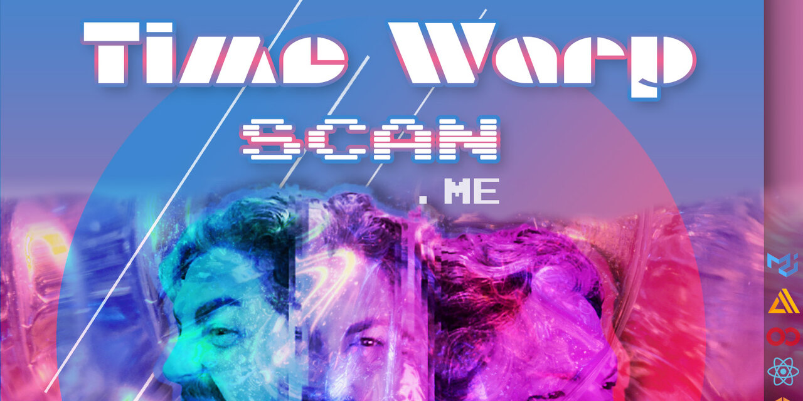

<p align="center">
  <a href="https://timewarpscan.me">
    
  </a>
</p>

<h1 align="center">TimeWarpScan.me</h1>

<p align="center">
  <strong>The viral <em>Time Warp Scan</em> filter, running 100% in your browser with TensorFlow.js.</strong><br />
  No app. No sign-up. No uploads. Just your webcam and a scan line that freezes time.
</p>

<p align="center">
  <a href="https://timewarpscan.me"></a>
  <a href="LICENSE"></a>
  <a href="https://github.com/GantMan/timewarp/stargazers"></a>
</p>

<p align="center">
  <a href="https://www.tensorflow.org/js"></a>
  <a href="https://react.dev"></a>
  <a href="https://vitejs.dev"></a>
  <a href="https://aws.amazon.com/amplify/hosting/"></a>
</p>

---

## ✨ What is it?

The **Time Warp Scan** is the effect that blew up on TikTok. A line sweeps across the camera and freezes every pixel it passes. Move while the line goes by and you can stretch your face, clone yourself, or pull off illusions that look impossible.

**[TimeWarpScan.me](https://timewarpscan.me)** recreates that filter on the open web:

- 🎥 **Live webcam scanning**, top-down or left-to-right
- 🎛️ **Controls**: scan speed ("brakes"), scan line size, delayed start, mirror, color/grayscale and looping
- 💾 **Download your result** as a PNG image or a recorded video
- 🔒 **Private by design**: every frame is processed on *your* device with WebGL. Nothing is uploaded or stored.
- 🆓 **Free and open source** (MIT)

👉 **Try it now at [timewarpscan.me](https://timewarpscan.me)**

## 🧠 How it works

Each webcam frame is turned into a tensor with [TensorFlow.js](https://www.tensorflow.org/js), and the scan builds the final image one strip at a time:

1. `tf.browser.fromPixels()` grabs the current video frame on the GPU.
2. The frame is resized to the canvas and optionally mirrored (`tf.reverse`).
3. A thin slice at the scan line's position is cut out with `tf.slice`.
4. That slice is `tf.concat`-ed onto the slices from earlier frames.
5. `tf.browser.toPixels()` paints the slice to a canvas, and a `MediaRecorder` captures the whole composite as video.

Each row (or column) of the result comes from a slightly different moment, which is what makes the "time warp" happen. Everything runs inside `tf.tidy()` and tensors are disposed as they go, so memory stays flat no matter how many scans you run.

The core logic lives in [`timewarpscanme/src/Scancam.jsx`](timewarpscanme/src/Scancam.jsx).

### 📚 Learn it step by step

The [`previous/`](previous) folder has the plain-HTML prototypes this project grew from. Each one adds a single feature, which makes it a good way to learn the technique:

| Step | File | Adds |
| --- | --- | --- |
| 1 | [`1simplest.html`](previous/1simplest.html) | The smallest working time warp scan |
| 2 | [`2efficient.html`](previous/2efficient.html) | Draws slices directly instead of re-rendering the whole tensor |
| 3 | [`3loops.html`](previous/3loops.html) | Continuous looping scans |
| 4 | [`4mirror.html`](previous/4mirror.html) | Mirrored (selfie) mode |
| 5 | [`5delay.html`](previous/5delay.html) | Delayed start so you can get in position |
| 6 | [`6workingvideo.html`](previous/6workingvideo.html) | Records the scan to video |

Want to go deeper? The techniques used here are covered in the book **[Learning TensorFlow.js](https://amzn.to/3dR3vpY)** (O'Reilly) by Gant Laborde.

## 🚀 Run it locally

You'll need Node.js 18+ and Yarn.

```sh
git clone https://github.com/GantMan/timewarp.git
cd timewarp/timewarpscanme
yarn
yarn start      # dev server on http://localhost:3000
```

| Command | What it does |
| --- | --- |
| `yarn start` | Start the Vite dev server with hot reload |
| `yarn build` | Production build into `timewarpscanme/build` |
| `yarn preview` | Serve the production build locally |

> Webcams only work on `localhost` or HTTPS, and your browser will ask for camera permission.

## ☁️ Deployment

The site is hosted on **AWS Amplify Hosting**, with DNS at name.com. Every push to `main` triggers a build:

- [`amplify.yml`](amplify.yml): build settings (monorepo app root `timewarpscanme`, Node 20, `yarn build`, publishes `build/`)
- [`customHttp.yml`](customHttp.yml): response headers (long-term caching for fingerprinted assets, security headers, camera permissions policy)

## 🗂️ Project structure

```
timewarp/
├── amplify.yml            # Amplify build spec
├── customHttp.yml         # Amplify response headers
├── previous/              # Step-by-step HTML prototypes
└── timewarpscanme/        # The React app
    ├── index.html         # SEO meta tags, Open Graph, JSON-LD
    ├── public/            # Static assets, sitemap, robots.txt, manifest
    └── src/
        ├── App.jsx        # Intro ↔ scanner switch (scanner is lazy-loaded)
        ├── Intro.jsx      # Landing page
        ├── Warper.jsx     # Scanner controls (Material UI)
        └── Scancam.jsx    # Webcam + TensorFlow.js time warp engine
```

## 🤝 Contributing

Issues and PRs are welcome! Good places to start:

- 🦊 **Firefox support.** The scanner currently has trouble in Firefox. If you can track down why, you're a hero.
- 📱 **Mobile layout** for the scanner screen
- 🎨 New scan modes (diagonal, radial, …)

## 👋 Credits

Created by **[Gant Laborde](https://gantlaborde.com)** ([@GantLaborde](https://twitter.com/GantLaborde)) of **[Infinite Red](https://infinite.red)**, the React Native and AI consultancy.

If you made something fun with it, share it and tag [@GantLaborde](https://twitter.com/GantLaborde)! And if you like the project, a ⭐ helps other people find it.

## 📄 License

[MIT](LICENSE) © Gant Laborde
